# ⚡ Awesome Data Transformation & Modeling

**A carefully curated index of industry-standard SaaS platforms and powerful open-source projects for Data Transformation, SQL-First Modeling, Visual Canvas ELT, Schema Evolution, and In-Warehouse Pipelines.**

*Last updated: October 2026*

---

## 🧭 Overview & Modern Analytics Engineering

Modern analytics teams treat data transformation not as an afterthought, but as pure software engineering. This repository catalogs notable **SaaS platforms** and **open-source frameworks** enabling analytics engineers, data engineers, and data teams to build, test, version control, and orchestrate transformation pipelines directly inside cloud lakehouses and data warehouses.

Whether you are seeking:
- **Code-First SQL Modeling** (treating models as modular, testable software assets with version control and CI/CD)
- **High-Performance Compute Engines** (transforming terabyte-scale datasets locally or in distributed lakehouses)
- **Visual Canvas & AI-Assisted ELT** (empowering analysts to design governed pipelines with column-level lineage)
- **Data Quality, Formatting & Static Type-Checking** (catching schema drift, formatting SQL, and ensuring runtime guarantees)

You will find vetted tools, starting pricing, free tier limits, star badges, and architectural trade-offs below.

---

## 📑 Table of Contents

- [📊 Sector Overview & Market Dynamics](#-sector-overview--market-dynamics)
- [🏢 SaaS / Hosted Platforms](#-saas--hosted-platforms)
- [⭐ Open-Source GitHub Projects](#-open-source-github-projects)
  - [Top Projects (Ranked by Star Count)](#top-projects-ranked-by-star-count)
  - [Architectural Patterns & Stack Synthesis](#architectural-patterns--stack-synthesis)
- [🤝 How to Contribute](#-how-to-contribute)
- [💖 Support & Community](#-support--community)
- [📈 Star History](#-star-history)
- [⚖️ Disclaimer & Engineering Trade-offs](#️-disclaimer--engineering-trade-offs)

---

## 📊 Sector Overview & Market Dynamics

The global data integration and data transformation software market is valued at approximately **$14B–$20B in 2026** and is projected to expand toward **$35B–$47B+ by the mid-2030s** at an estimated **11%–14% CAGR**, propelled by real-time analytics and enterprise AI/LLM readiness pipelines. The sector is **moderately fragmented yet anchored by a concentrated core**: hyperscalers (AWS, Microsoft, Google) and legacy data management titans (Informatica, Talend/Qlik) dominate high-governance enterprise workloads, while agile cloud-native pure-plays (Databricks, Fivetran, Coalesce, Matillion) fiercely contest modern lakehouse and warehouse-centric modeling.

---

## 🏢 SaaS / Hosted Platforms

Below is the comparative breakdown of leading enterprise SaaS and hosted transformation platforms, ordered descending by organizational scale and valuation:

| Platform | Estimated Scale / Valuation | Starting Pricing | Free Tier / Trial Limits | Key Capabilities & Best For |
|---|---|---|---|---|
| **AWS Glue** | **~$2.0T+** (Amazon market cap; AWS ARR >$105B) | **$0.44 per DPU-hour** (Glue ETL jobs, 1-min minimum); DataBrew: **$0.48 / 30-min session** & **$0.46 / node-hour** | **Forever free**: First **1,000,000 objects stored** and **1,000,000 requests/month** in AWS Glue Data Catalog (compute ETL jobs billed per-second) | Serverless Spark ETL, visual data preparation (DataBrew), and metadata management for AWS-native cloud architectures. |
| **Databricks Lakehouse** | **$134B** (valuation, Series L) | **$0.15 / DBU** (Data Engineering jobs / pipelines) to **$0.22 / DBU** (SQL Warehouses); serverless pay-as-you-go | **14-day free trial** with up to **$400 in usage credits** (full commercial evaluation); also provides a **Community / Free Edition** restricted to non-commercial learning with 1 2X-Small SQL warehouse and daily fair-usage caps | Unified lakehouse platform leveraging Delta Live Tables, Spark SQL, and Unity Catalog governance for data and ML pipelines. |
| **Informatica Cloud** | **~$7.5B** (market cap / ~$1.6B ARR) | **~$90–$100 per IPU/month** via pre-purchased capacity tiers (entry enterprise contracts typically start at **$80,000/year**) | **Forever free tier**: **25 IPUs (Informatica Processing Units) per month** on Cloud Data Integration Free Service; or **30-day full feature trial** | Enterprise data integration and governance platform with extensive pre-built enterprise connectors (SAP, mainframe). |
| **Fivetran Transform** | **$5.6B** (valuation; >$325M ARR) | **~$500 per million MAR** on Standard plan (+ **$5/month floor per connection**) | **Forever free tier**: Up to **500,000 connector MAR/month**, **3,500 activation MAR/month**, and **5,000 monthly model runs** (dbt Core / SQL transforms) | Managed transformation and ELT layer integrated directly into Fivetran's automated pipeline ecosystem. |
| **Talend Data Fabric** | **~$3.1B** (acquired by Qlik / ~$400M+ revenue) | **~$30,000/year** entry-level quote for Qlik Talend Cloud Standard (volume-metered by GB/TB transferred) | **14-day free trial** with unrestricted pipeline access and a **7-day historical sync grace period** (desktop Open Studio was retired in 2024) | Enterprise data integration, cataloging, and stewardship workflows across hybrid and complex multi-cloud environments. |
| **Matillion** | **$1.5B** (valuation; ~$80M ARR) | **~$2.00–$3.50 per credit** on consumption plans; pipelines meter at **3 credits/task-hour for transforms** and **1 credit/task-hour for orchestration** | **14-day free trial** with **500 free usage credits** and unrestricted access to all platform components and connectors | Visual, drag-and-drop cloud-native ELT platform pushing SQL transformations down into Snowflake, Databricks, Redshift, and BigQuery. |
| **Prophecy** | **$268M** (valuation; ~$30M ARR) | **Starter plan at $0**; **Professional at $150/user/month** (includes 50 credits/user/month); **Enterprise Express at $4,000/year** (up to 20 users) | **Forever free Starter plan**: **20 credits/month**, embedded DuckDB execution, and 5 transpiler imports/month | AI-first visual pipeline and SQL canvas (Transform Agent, Document Agent) supporting Spark and legacy Alteryx/Informatica transpilation. |
| **Keboola** | **$128M** (valuation; ~$10M ARR) | **Data Craft at €49/user/month** (includes 600 minutes/month, then €0.125/minute); **Data Teams at €79/user/month** | **Forever free tier**: **120 free compute minutes** in month 1, and **60 free minutes/month** thereafter (additional usage billed at $0.14/min) | All-in-one data operations platform offering SQL/Python transformations, native Snowflake storage, MCP agent server, and EU data residency. |
| **Coalesce** | **~$90M–$100M** (est. valuation, $87M raised; ~$20M ARR) | **Starter plan at $500/month** (includes 2,000 credits/month); Enterprise plans custom | **Forever free tier**: Development environments are **always free for individual developers**; **30-day trial** available for team/production features | Column-aware visual data modeling, quality, and cataloging platform generating governed SQL natively for Snowflake. |

---

## ⭐ Open-Source GitHub Projects

Open-source technologies form the bedrock of the modern data stack. These tools empower teams to maintain complete control over compute costs, avoid vendor lock-in, and deploy automated data pipelines on local development workstations, on-premises clusters, or any cloud environment.

### Top Projects (Ranked by Star Count)

Repos below are sorted in **descending order by GitHub star count**. Each project includes a social star badge linking directly to its stargazer community:

- **Apache Spark**   
  **Unified engine for large-scale distributed data transformation and processing** (Apache-2.0) . Supports DataFrame APIs and Spark SQL across Python, Scala, Java, and R . Provides execution engines for batch processing, streaming, machine learning, and petabyte-scale ETL pipelines . **Best for**: massive distributed data processing and hybrid big-data architectures .

- **DuckDB**   
  **High-performance in-process analytical SQL OLAP database management engine** (MIT) . Often hailed as the "SQLite for Analytics," DuckDB executes zero-copy vector transformations on Parquet, CSV, Arrow, and JSON files without requiring external database services . **Best for**: fast local analytical transformations, embedded pipelines, and DuckLake architectures .

- **Polars**   
  **Blazingly fast multi-threaded DataFrame transformation engine written in Rust** (MIT) . Employs Apache Arrow memory structures, lazy query optimization, and streaming execution for larger-than-RAM dataset transformations . **Best for**: modern high-throughput data engineering pipelines looking for an ultrafast Python/Rust alternative to pandas .

- **dbt (data build tool)**   
  **The de-facto standard for in-warehouse SQL transformation and analytics engineering** (Apache-2.0 for Core) . Enables analysts to write modular `.sql` SELECT statements enriched with Jinja templating, comprehensive schema testing, and auto-generated data documentation . Compiles to warehouse-native SQL (Snowflake, BigQuery, Redshift, Databricks) . **Best for**: analytics engineering teams seeking modular software engineering best practices inside their warehouse .

- **SQLFluff**   
  **The dialect-flexible, extensible SQL linter and auto-formatter** (MIT) . Supports dbt templating, Jinja logic, and dozens of warehouse SQL dialects (Snowflake, BigQuery, DuckDB, Postgres, T-SQL) . Enforces standardized SQL styling and detects syntax errors during CI/CD before models reach production . **Best for**: enforcing governance, readability, and consistency across team-maintained SQL models .

- **SQLGlot**   
  **Comprehensive, pure-Python SQL parser, transpiler, optimizer, and lineage engine** (MIT) . Transpiles queries seamlessly across 20+ SQL dialects, constructs abstract syntax trees (ASTs), and traces end-to-end column lineage . Powers leading query optimization and semantic modeling frameworks . **Best for**: cross-warehouse query translation, semantic layer development, and automated schema migrations .

- **Apache DataFusion**   
  **Extensible, high-performance vectorized SQL query engine written in Rust** (Apache-2.0) . Uses Apache Arrow as its in-memory format to provide composable building blocks for developing custom query engines, transformations, and modern distributed data platforms . **Best for**: developers crafting bespoke transformation tools and memory-efficient data compute frameworks .

- **Ibis**   
  **The portable Python DataFrame API for 20+ data analytical backends** (Apache-2.0) . Write idiomatic Python code once and execute it directly across DuckDB, Snowflake, BigQuery, ClickHouse, Postgres, or Polars without writing engine-specific SQL dialects . **Best for**: Python developers wanting high-level DataFrame syntax while leveraging warehouse push-down compute .

- **SQLMesh**   
  **Next-generation data transformation platform with virtual data environments** (Apache-2.0) . Provides compile-time SQL validation, automatic column-level lineage, and virtual data isolation (instant environment promotion without copying or recreating physical schemas) . Fully backwards compatible with dbt projects . **Best for**: teams seeking an efficient, safe alternative to dbt with native column lineage and instant dev/prod environments .

- **Dataform**   
  **SQL transformation and dependency orchestration framework for cloud data warehouses** (Apache-2.0) . Developed with a SQLX syntax combining SQL and JavaScript for dynamic table assertions and lineage graphs; now maintained as Google Cloud's native BigQuery transformation layer . **Best for**: BigQuery-focused engineering teams requiring built-in orchestration and native assertions .

- **fal**   
  **Python environment extension for dbt workflows and AI transformation pipelines** (MIT) . Run Python scripts, machine learning models, and predictive analytics directly after dbt model runs with native cloud execution and scheduling . **Best for**: augmenting dbt pipelines with Python algorithms, feature engineering, and inference tasks .

- **Rocky**   
  **Type-safe SQL compiler with compile-time type inference and diagnostic validation** (Apache-2.0) . Validates data contracts and schema compatibility before queries run against the warehouse . Features partition-level time interval materialization (`--lookback`, `--missing`) and static column-level lineage exported to JSON/Graphviz . **Best for**: teams wanting compile-time validation, partition concurrency, and CI/CD schema regression checks .

- **interlace**   
  **All-in-one data engine unifying transformation, orchestration, and durable streaming in a single daemon** (MIT) . Replaces complex multi-tool stacks (dbt + Airflow + ingestion agents) with a declarative plan/apply workflow, column-pruned table reuse, and native DuckDB/DuckLake execution . **Best for**: lean engineering teams seeking a single, zero-dependency process for data transformation and orchestration .

- **unwind-sql**   
  **SQL orchestration engine with AST-backed deterministic value-level lineage** (Apache-2.0) . Traces individual values and math transformations through Jinja SQL models down to the exact computed result . Features an interactive DAG visualizer and optional LLM root-cause investigator . **Best for**: financial, medical, and auditing workloads requiring explainable, deterministic value-level provenance .

- **Reble**   
  **Branch-first SQL transformation with git-like environment isolation** (Apache-2.0) . Freezes table snapshots upon branch creation (`reble branch create`), computes model changes against identical input snapshots, and generates row-level diffs (`reble diff`) before promoting with zero downtime . **Best for**: safe team collaboration preventing dev-schema collision and untracked input data drift .

---

### 🧩 Architectural Patterns & Stack Synthesis

Modern data transformation architectures typically blend multiple layers of the ecosystem:
1. **The In-Warehouse Standard**: Pair **dbt Core** or **SQLMesh** with **SQLFluff** for linting, and run models inside Snowflake, BigQuery, or Databricks.
2. **The High-Speed Local Stack**: Combine **DuckDB** or **Polars** with **Ibis** or **SQLGlot** to process multi-gigabyte datasets directly in Python on a laptop with zero warehouse fees.
3. **The Governed Enterprise Stack**: Deploy **Coalesce** or **Prophecy** atop cloud warehouses for visual and AI-assisted modeling while maintaining underlying Git repository sync.

---

## 🤝 How to Contribute

We welcome contributions from the data engineering community! To add or update an entry:

1. **Fork** this repository.
2. **Create a branch** for your updates (`git checkout -b add-transformation-tool`).
3. Add or update entries following the established markdown schema:
   - For SaaS products: include scale/valuation, starting pricing, and specific free tier limits.
   - For Open-Source projects: include the GitHub social star badge (`style=social&color=white`) linking to its stargazers page, license, and primary architectural strengths.
4. Keep descriptions factual, unbiased, and focused on analytics engineering merit.
5. **Submit a Pull Request** with a brief summary of the added project.

---

## 💖 Support & Community

If you find this curated resource helpful for navigating data modeling and transformation architectures, please consider supporting the project:

- ⭐ **Star this repository** to help others discover it across GitHub.
- 🍴 **Fork and contribute** new tools, benchmarks, and ecosystem updates.
- 📢 **Share with fellow analytics engineers** on Discord, LinkedIn, and tech communities.
- ☕ **Sponsor the Maintainer**: Support ongoing curation and open-source research by visiting the [Sponsor Dashboard](https://github.com/sponsors/ishandutta2007).

---

## 📈 Star History

---

## ⚖️ Disclaimer & Engineering Trade-offs

- **Community Curation**: This is an independent, community-driven guide — not an endorsement of any commercial platform or vendor.
- **Code-First vs. Visual Canvas**: Code-first frameworks (dbt, SQLMesh) favor developer ergonomics, Git versioning, pull requests, and automated CI tests, but demand SQL/Jinja proficiency. Visual canvases (Coalesce, Matillion, Prophecy) accelerate analyst onboarding and non-technical workflow authoring, but require strict governance to avoid pipeline sprawl.
- **Cost Transparency**: Cloud warehouse compute costs are incurred in addition to software platform fees for ELT tools that push compute down into Snowflake, BigQuery, Redshift, or Databricks. Always estimate monthly query volumes and test execution plans prior to enterprise commitment.
- **Compliance & Security**: Organizations processing regulated workloads (HIPAA, GDPR, SOC 2, CCPA) must ensure that any self-hosted or SaaS transformation layer upholds tenant isolation, metadata encryption, and access controls.

---

**Crafted with care for analytics engineers, data teams, and modern data stack builders.**  
*Accelerating open, version-controlled, and governed data transformation.*

